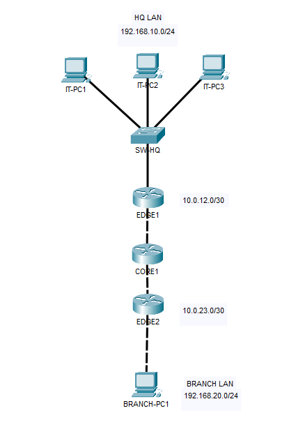
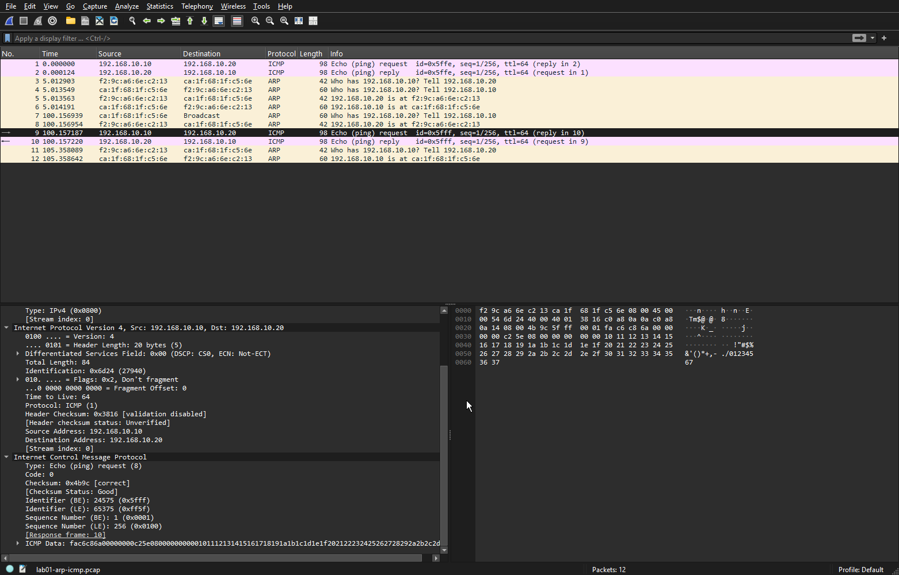

<h1 align="center">Networking Labs</h1>

<p align="center"><strong>Hands-on network engineering — from first packets to routed infrastructure.</strong></p>

<p align="center">A practical portfolio of reproducible networking labs built with Linux, Kathara, Docker, FRRouting, and Wireshark.</p>

<p align="center">
  
  
  
</p>

---

## About the project

This repository documents hands-on exercises in **network configuration, packet analysis, routing, and troubleshooting**. Each lab is designed to be reproducible: the topology, startup configuration, test commands, and evidence are kept together.

The focus is on understanding *why* networks behave the way they do—not just making commands work.

## Laboratory index

| Lab | Topics | Evidence | Status |
| :-- | :-- | :-- | :-- |
| **[01 · Basic Network Connectivity](labs/01-basic-connectivity/README.md)** | IPv4, Ethernet, ARP, ICMP, network testing | Kathara config, Wireshark screenshots, PCAP | **Completed** |
| **[02 · Multi-Network Routing & FRRouting](labs/02-multi-network-routing/README.md)** | Multi-hop routing, default gateways, Linux static routes, IP forwarding, FRRouting/Zebra, TTL | Kathara config, 30 screenshots, PCAPs, Packet Tracer topology | **Completed** |

## Featured lab · Multi-Network Routing & FRRouting

A headquarters LAN (`192.168.10.0/24`) and a branch LAN (`192.168.20.0/24`) communicate across **three Linux routers** (`edge1 → core1 → edge2`) and two point-to-point `/30` networks. The lab compares static routing configured through Linux `ip route` with static routes managed by **FRRouting 10.5.3**.

Key experiments include identifying missing routes, enabling IPv4 forwarding, tracing each hop, inspecting ICMP packets on both sides of a router, and verifying that FRRouting configurations are restored automatically after a Kathara restart.

**Verified outcome:** `4 packets transmitted, 4 received, 0% packet loss` · Average RTT: **2.695 ms** (HQ to branch, after FRRouting restart).

<p align="center">
  
</p>

<p align="center"><em>Topology visualized in Cisco Packet Tracer; implemented and tested in Kathara.</em></p>

**[Read the full LAB 02 report →](labs/02-multi-network-routing/README.md)** · [View FRRouting validation](labs/02-multi-network-routing/screenshots/30-frr-restart-and-connectivity-validation.png) · [Browse screenshots](labs/02-multi-network-routing/screenshots/) · [View PCAPs](labs/02-multi-network-routing/shared/)

## LAB 01 · Basic Network Connectivity

Two Linux hosts share a virtual LAN (`192.168.10.0/24`). The lab demonstrates how they discover each other's MAC addresses using ARP and exchange ICMP Echo Request / Echo Reply packets.

**Verified outcome:** `4 packets transmitted, 4 received, 0% packet loss` · Average RTT: **0.888 ms**.

<p align="center">
  
</p>

<p align="center"><em>Wireshark analysis of an ICMP Echo Request captured in LAB 01.</em></p>

**[Read the full LAB 01 report →](labs/01-basic-connectivity/README.md)** · [View packet capture](labs/01-basic-connectivity/shared/lab01-arp-icmp.pcap) · [Browse screenshots](labs/01-basic-connectivity/screenshots/)

## Tools and technologies

| Tool | How it is used |
| :-- | :-- |
| **Kathara + Docker** | Build isolated, repeatable network topologies |
| **Linux / iproute2** | Configure interfaces, forwarding, routes, and default gateways |
| **FRRouting / Zebra** | Manage and inspect router routing tables and persistent static routes |
| **tcpdump** | Capture traffic and save PCAP files |
| **Wireshark** | Inspect Ethernet, ARP, IPv4, ICMP, and TTL changes |
| **Cisco Packet Tracer** | Visualize the LAB 02 topology (not the execution environment) |
| **Git + GitHub** | Track changes and publish technical documentation |

## Repository structure

```text
networking-labs/
├── README.md
├── .gitignore
├── .gitattributes
└── labs/
    ├── 01-basic-connectivity/
    │   ├── README.md
    │   ├── lab.conf
    │   ├── pc1.startup
    │   ├── pc2.startup
    │   ├── screenshots/
    │   └── shared/
    │       └── lab01-arp-icmp.pcap
    └── 02-multi-network-routing/
        ├── README.md
        ├── lab.conf
        ├── *.startup
        ├── configs/static-routing/
        ├── shared/                 # FRR configuration and PCAP evidence
        ├── screenshots/            # 30 documented screenshots
        └── topology/               # Packet Tracer project and image
```

## Run the labs

**Prerequisites:** Docker and Kathara installed and working on your system. FRRouting router images are specified in LAB 02's `lab.conf` and will be obtained by Docker/Kathara when required.

### LAB 01 · Basic connectivity

Open a terminal in the repository directory and run:

```powershell
cd labs/01-basic-connectivity
kathara lstart --noterminals
kathara exec pc1 "ping -c 4 192.168.10.20"
kathara lclean
```

The `.startup` files assign the IPv4 addresses automatically. Detailed configuration steps, packet analysis, and troubleshooting notes are available in the [LAB 01 documentation](labs/01-basic-connectivity/README.md).

### LAB 02 · Multi-network routing

From the repository root:

```powershell
cd labs/02-multi-network-routing
kathara lstart --noterminals
kathara exec core1 "vtysh -c 'show ip route'"
kathara exec itpc1 "ping -c 4 192.168.20.10"
kathara lclean
```

The router startup scripts restore the saved FRRouting configurations from `shared/`, start FRR, and load the configured static routes. See the [LAB 02 documentation](labs/02-multi-network-routing/README.md) for addressing, routing tables, packet captures, and the restart validation.

---

<sub>Documenting practical progress in networking, Linux administration, routing, and infrastructure troubleshooting.</sub>
