# LAB 02 — Multi-Network Routing & FRRouting

**A reproducible, multi-site IPv4 network built with Kathara and Linux, featuring static routing, FRRouting (Zebra), traceroute, packet analysis, and automated router startup.**

**Technology stack:** Kathara · Docker · Linux · FRRouting 10.5.3 · `iproute2` · `tcpdump` · Wireshark · Cisco Packet Tracer (diagram only)

---

## Project overview

This project simulates connectivity between a head office (**HQ**) and a remote **BRANCH** through three Linux routers. It begins with basic IPv4 connectivity and manual static routes, then migrates route management to **FRRouting (FRR)**. The lab concludes with a clean Kathara restart that restores router configurations and successfully passes end-to-end traffic.

**Scope:** 7 Linux devices · 4 Ethernet segments · 3 routers · 2 end-user LANs

> **Implementation note:** The topology graphic was drawn in Cisco Packet Tracer for documentation. The actual network, routing, experiments, and packet captures were implemented in **Kathara**. The `.pkt` file is a visual reference, not a configured equivalent of the Kathara environment.

## Network topology


```text
  HQ / 192.168.10.0/24
  IT-PC1    IT-PC2    IT-PC3
      \       |       /
       \      |      /
        [HQ Ethernet segment]
                |
    edge1 eth0: 192.168.10.1
         [ EDGE1 ]
    edge1 eth1: 10.0.12.1
                |
        LINK1 10.0.12.0/30
                |
    core1 eth0: 10.0.12.2
         [ CORE1 ]
    core1 eth1: 10.0.23.1
                |
        LINK2 10.0.23.0/30
                |
    edge2 eth0: 10.0.23.2
         [ EDGE2 ]
    edge2 eth1: 192.168.20.1
                |
      BRANCH / 192.168.20.0/24
                |
       BRANCH-PC1: 192.168.20.10
```

The `HQ` and `BRANCH` segments are Ethernet collision domains in Kathara. The Packet Tracer drawing includes an HQ switch to represent the shared LAN visually; **no switch container is required in Kathara**.

### IPv4 addressing plan

| Device | Interface | Address / prefix | Connected segment | Gateway (hosts only) |
|---|---|---|---|---|
| IT-PC1 (`itpc1`) | `eth0` | `192.168.10.10/24` | HQ | `192.168.10.1` |
| IT-PC2 (`itpc2`) | `eth0` | `192.168.10.20/24` | HQ | `192.168.10.1` |
| IT-PC3 (`itpc3`) | `eth0` | `192.168.10.30/24` | HQ | `192.168.10.1` |
| EDGE1 (`edge1`) | `eth0` | `192.168.10.1/24` | HQ | — |
| EDGE1 (`edge1`) | `eth1` | `10.0.12.1/30` | LINK1 | — |
| CORE1 (`core1`) | `eth0` | `10.0.12.2/30` | LINK1 | — |
| CORE1 (`core1`) | `eth1` | `10.0.23.1/30` | LINK2 | — |
| EDGE2 (`edge2`) | `eth0` | `10.0.23.2/30` | LINK2 | — |
| EDGE2 (`edge2`) | `eth1` | `192.168.20.1/24` | BRANCH | — |
| BRANCH-PC1 (`branchpc1`) | `eth0` | `192.168.20.10/24` | BRANCH | `192.168.20.1` |

The point-to-point router links use `/30` subnets, providing two usable IPv4 addresses per link.

## Repository contents

```text
02-multi-network-routing/
├── README.md
├── lab.conf
├── itpc1.startup
├── itpc2.startup
├── itpc3.startup
├── branchpc1.startup
├── edge1.startup                 # FRR-based automated router startup
├── core1.startup
├── edge2.startup
├── configs/
│   └── static-routing/         # Backup of the earlier Linux routing scripts
│       ├── edge1.startup
│       ├── core1.startup
│       └── edge2.startup
├── topology/
│   ├── network-topology.png
│   └── network-topology.pkt
├── shared/
│   ├── edge1-frr.conf
│   ├── core1-frr.conf
│   ├── edge2-frr.conf
│   ├── edge1-eth0.pcap
│   └── edge1-eth1.pcap
└── screenshots/
    ├── 01-kathara-lab-conf.png
    ├── ...                     # Original implementation and Wireshark evidence
    ├── 20-wireshark-icmp-reply-edge1-eth0.png
    ├── 21-frr-router-images-lab-conf.png
    ├── ...                     # FRR configuration, routing and test evidence
    └── 30-frr-restart-and-connectivity-validation.png
```

All documented captures refer to this experiment. The MAC addresses shown in Wireshark can change when Kathara containers are recreated.

## Reproduce the environment

### Prerequisites

- Docker running on the host
- Kathara installed and configured
- Access to the `kathara/frr` container image (downloaded automatically if needed)
- Wireshark (optional, for PCAP inspection)
- Cisco Packet Tracer (optional, for opening the diagram `.pkt`)

### Start and validate

Run these commands from this lab directory:

```powershell
kathara lstart --noterminals
kathara linfo
```

The router entries in `lab.conf` select the FRRouting image:

```ini
edge1[image]="kathara/frr"
core1[image]="kathara/frr"
edge2[image]="kathara/frr"
```

Each router's `.startup` script configures interface addresses, enables IPv4 forwarding, restores its saved FRR configuration from `/shared/`, starts FRR, and applies the integrated configuration with `vtysh -b`.

For example, **EDGE1** includes:

```bash
ip link set eth0 up
ip link set eth1 up
ip addr add 192.168.10.1/24 dev eth0
ip addr add 10.0.12.1/30 dev eth1
sysctl -w net.ipv4.ip_forward=1
install -o frr -g frrvty -m 640 /shared/edge1-frr.conf /etc/frr/frr.conf
service frr start
vtysh -b
```

The `shared/` directory contains the actual FRR configurations used during the successful restart test; **keep it alongside `lab.conf`**.

### Test connectivity and routing

```powershell
# HQ local connectivity
kathara exec itpc1 "ping -c 4 192.168.10.20"

# Full route across three routers
kathara exec itpc1 "ping -c 4 192.168.20.10"

# Discover the network path
kathara exec itpc1 "traceroute -n 192.168.20.10"

# Inspect FRR and Linux routing tables
kathara exec core1 "vtysh -c 'show ip route'"
kathara exec edge1 "ip route"
```

Shut down the lab when finished:

```powershell
kathara lclean
```

## Experiment 1 — Local connectivity and missing routes

The three HQ workstations share `192.168.10.0/24`. The first test, **IT-PC1 → IT-PC2**, succeeded without crossing any router:

- **4 sent / 4 received / 0% loss**
- **Average RTT: 0.977 ms**

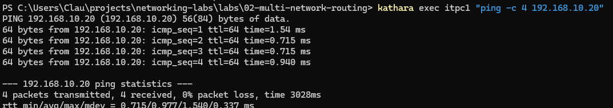

Before routes were added, the HQ-to-branch ping failed:

```text
From 192.168.10.1: Destination Net Unreachable
4 packets transmitted, 0 received, +4 errors, 100% packet loss
```

EDGE1 only knew its directly connected networks: `192.168.10.0/24` and `10.0.12.0/30`. The ICMP error originated from EDGE1 (`192.168.10.1`), indicating it did not have a path toward BRANCH.

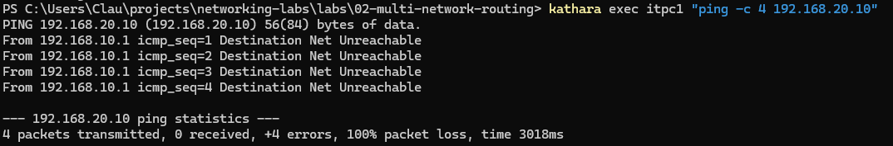

## Experiment 2 — Linux static routing

Routes were first introduced directly in the Linux kernel with `ip route add`.

| Router | Destination | Next hop |
|---|---|---|
| EDGE1 | `192.168.20.0/24` | `10.0.12.2` (CORE1) |
| CORE1 | `192.168.10.0/24` | `10.0.12.1` (EDGE1) |
| CORE1 | `192.168.20.0/24` | `10.0.23.2` (EDGE2) |
| EDGE2 | `192.168.10.0/24` | `10.0.23.1` (CORE1) |

The three routers were confirmed to have `net.ipv4.ip_forward = 1`. Once the forward and return routes were present, end-to-end ping succeeded with **0% packet loss**.

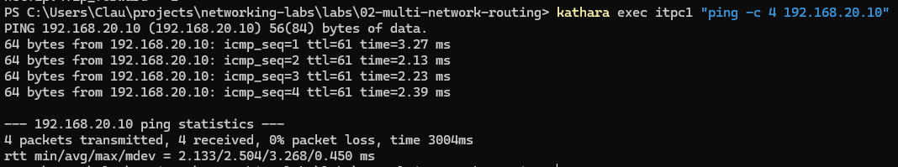

The legacy router scripts from this phase are retained in [`configs/static-routing/`](configs/static-routing/) for comparison. They are **not** the active FRR startup scripts in the lab root.

### Traceroute

The path from IT-PC1 to BRANCH-PC1 was measured as follows:

| Hop | Address | Device |
|---:|---|---|
| 1 | `192.168.10.1` | EDGE1 |
| 2 | `10.0.12.2` | CORE1 |
| 3 | `10.0.23.2` | EDGE2 |
| 4 | `192.168.20.10` | BRANCH-PC1 (destination) |

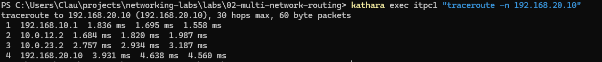

The destination appears as hop 4, but **only three routers** are traversed.

## Experiment 3 — Wireshark packet analysis

`tcpdump` captured the same ping exchange at two interfaces of EDGE1:

```bash
# Run simultaneously in separate EDGE1 terminals
# Incoming HQ-side interface
tcpdump -i eth0 -nn -w /shared/edge1-eth0.pcap 'arp or icmp'

# Outgoing core-facing interface
tcpdump -i eth1 -nn -w /shared/edge1-eth1.pcap 'arp or icmp'
```

Then generate traffic from a host terminal:

```powershell
kathara exec itpc1 "ping -c 4 192.168.20.10"
```

Stop both captures with **Ctrl+C**. Open the recorded `.pcap` files in Wireshark; they are stored in [`shared/`](shared/).

Wireshark display filter for requests:

```text
icmp && ip.src == 192.168.10.10 && ip.dst == 192.168.20.10
```

### Measured packet changes at EDGE1

| Field | Request on eth0 (in) | Request on eth1 (out) |
|---|---|---|
| Source IPv4 | `192.168.10.10` | `192.168.10.10` |
| Destination IPv4 | `192.168.20.10` | `192.168.20.10` |
| IPv4 TTL | **64** | **63** |
| Ethernet source MAC | `02:91:d7:a5:b4:98` | `e2:90:d4:81:2a:58` |
| Ethernet destination MAC | `3e:af:c1:3a:dd:ec` | `aa:ab:05:c6:db:e8` |
| ICMP type | 8 (Echo Request) | 8 (Echo Request) |

**Incoming request — EDGE1 eth0**

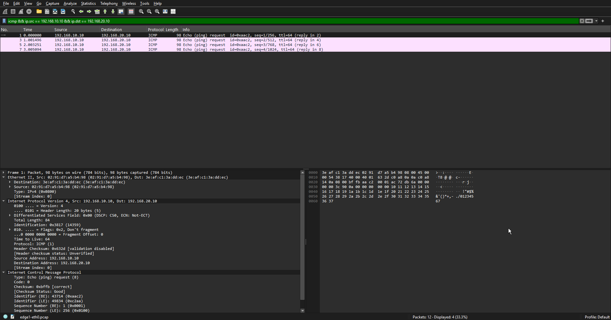

**Forwarded request — EDGE1 eth1**

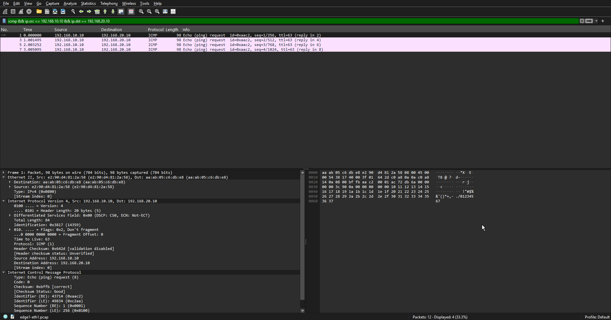

The same ICMP Identifier (`0xaac2`) and Sequence Number (`1`) link the two observations of the Echo Request.

On the reverse path, the Echo Reply arrives on EDGE1 `eth1` with **TTL 62** and leaves on `eth0` with **TTL 61**. The IPv4 source and destination stay the same across the router, but the Ethernet MAC addresses are rewritten for the new link.

<details>
<summary>View ICMP Echo Reply evidence (both interfaces)</summary>

**EDGE1 eth1 — Echo Reply arriving from CORE1**

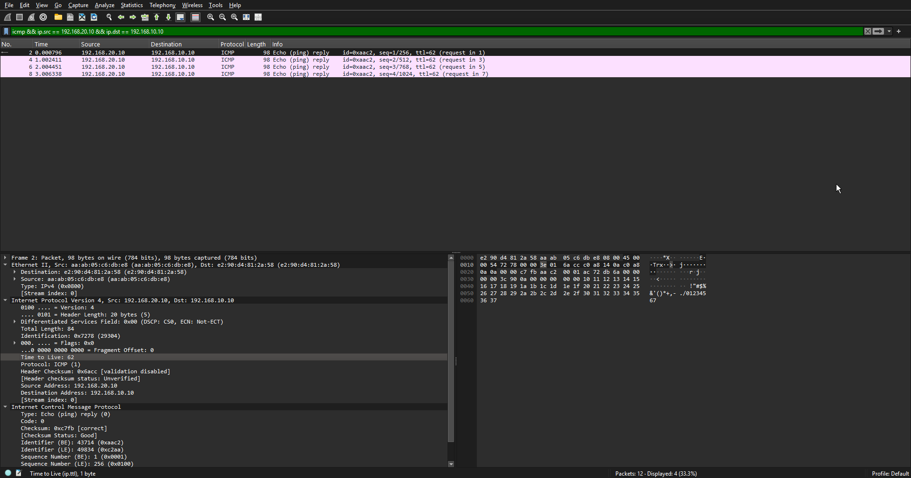

**EDGE1 eth0 — Echo Reply forwarded to IT-PC1**

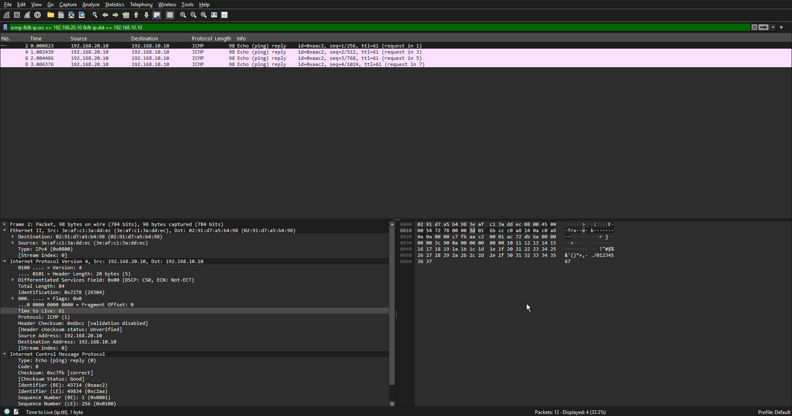

</details>

**What this shows:** IPv4 forwarding decrements TTL, recalculates the IPv4 header checksum as necessary, and re-encapsulates traffic in a new Ethernet frame. It does not alter end-host IP addresses in this setup because no NAT is configured.

## Experiment 4 — Static routes managed by FRRouting

The project then switched the three routers to **`kathara/frr`**, removed `ip route add` entries from the active `.startup` scripts, and configured routes via `vtysh`.

FRR **10.5.3** was used. The initial `vtysh` attempt returned `failed to connect to any daemons`, which was resolved by starting the daemon service with `service frr start`. Subsequent automated startup was incorporated into the router scripts.

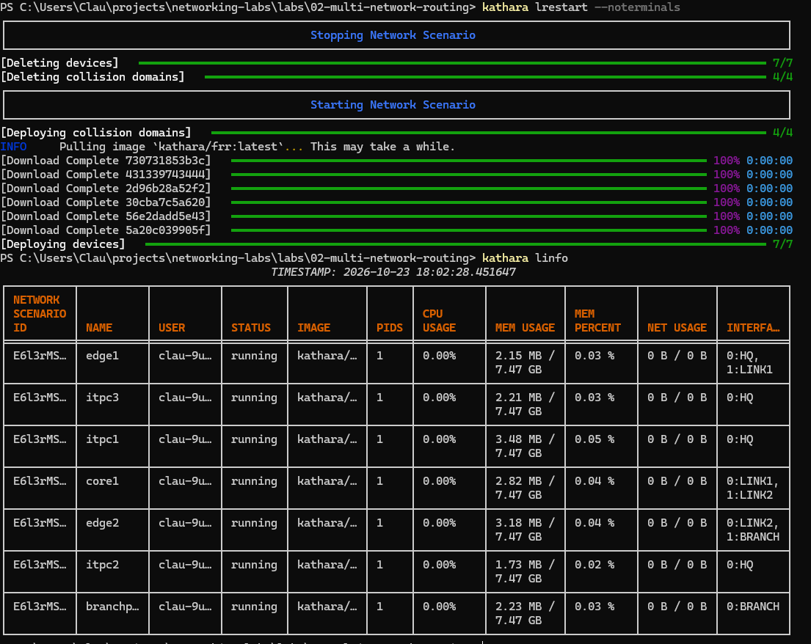

The saved integrated FRR configurations contain these routes:

**EDGE1**

```text
ip route 192.168.20.0/24 10.0.12.2
```

**CORE1**

```text
ip route 192.168.10.0/24 10.0.12.1
ip route 192.168.20.0/24 10.0.23.2
```

**EDGE2**

```text
ip route 192.168.10.0/24 10.0.23.1
```

The `S>*` notation in `show ip route` confirms a static route selected and installed for forwarding.

<details>
<summary>View FRR configuration and routing evidence</summary>

**FRR image selection**

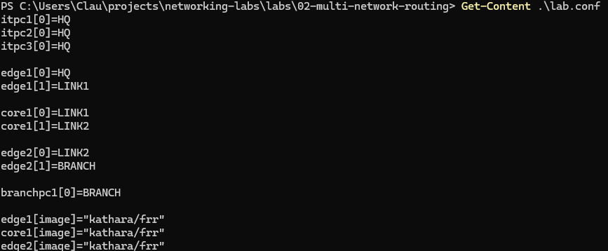

**EDGE1 connected routes and initial routing table**

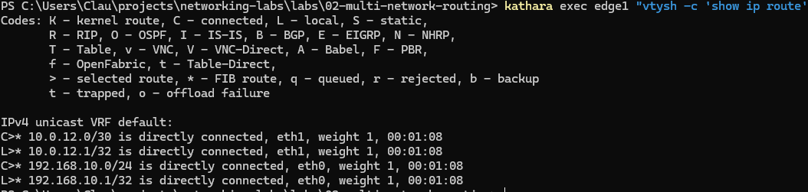

**EDGE1 static route**

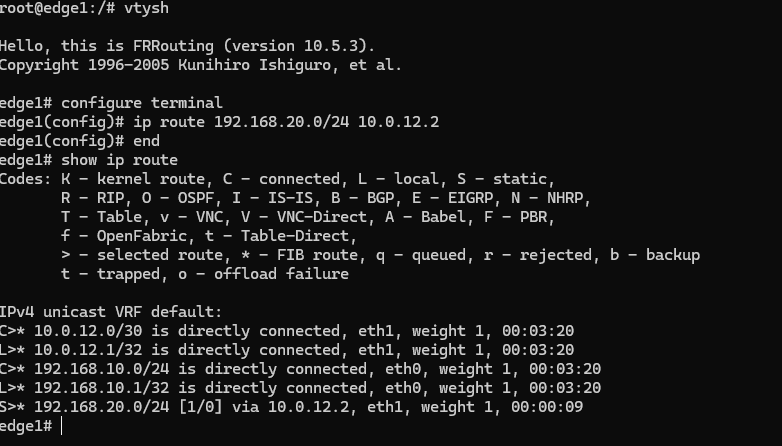

**EDGE1 saved running configuration**

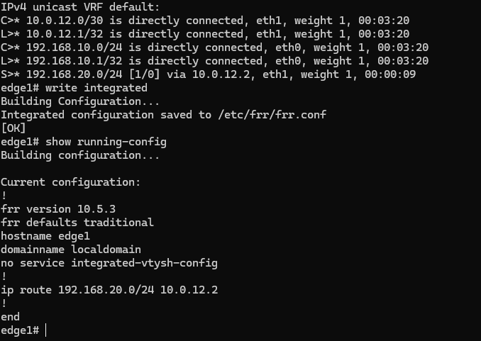

**CORE1 routes to HQ and BRANCH**

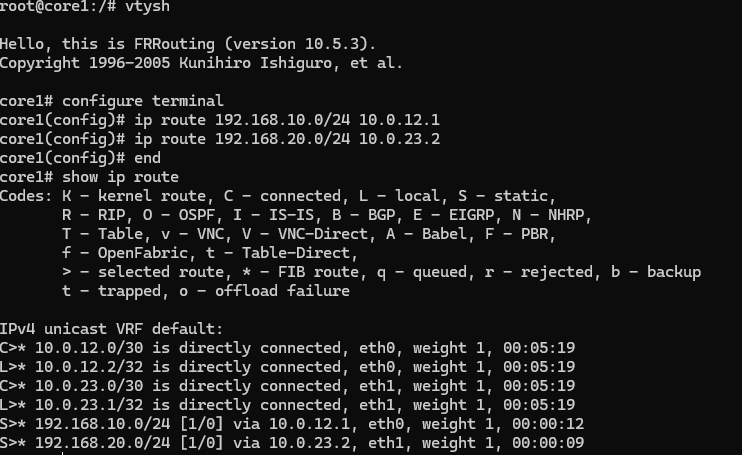

**EDGE2 return route to HQ**

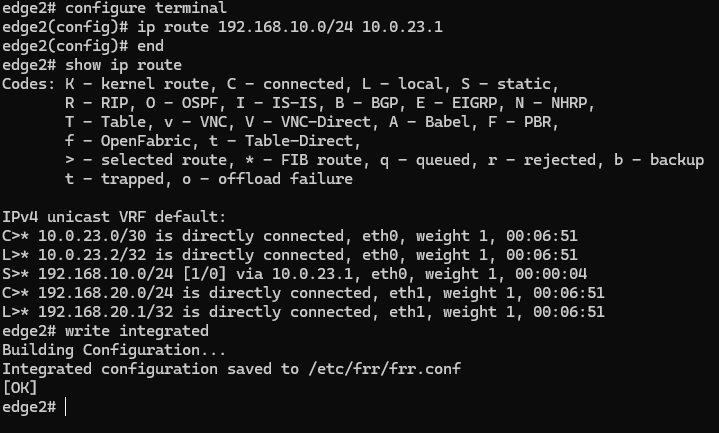

</details>

### FRR and Linux routing-table consistency

A route configured using FRR:

```text
S>* 192.168.20.0/24 [1/0] via 10.0.12.2, eth1
```

was also visible in the Linux kernel:

```text
192.168.20.0/24 nhid 6 via 10.0.12.2 dev eth1 proto static metric 20
```

This demonstrates that FRR **manages and installs the routes**, while Linux handles actual packet forwarding.

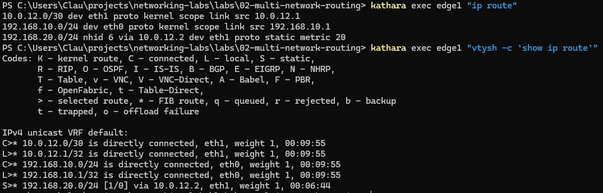

## Final validation — Reproducibility after restart

To verify the project can be started again without manual commands, all devices were recreated using:

```powershell
kathara lrestart --noterminals
```

Following that restart, CORE1's FRR table contained both restored `S>*` routes and IT-PC1 successfully pinged BRANCH-PC1.

| Final test | Recorded result |
|---|---|
| Kathara devices started | **7 / 7** |
| Ethernet domains deployed | **4 / 4** |
| HQ → BRANCH packets | **4 transmitted, 4 received** |
| Packet loss | **0%** |
| Average RTT | **2.695 ms** |
| TTL observed at IT-PC1 | **61** |
| FRR routing entries | Restored automatically |

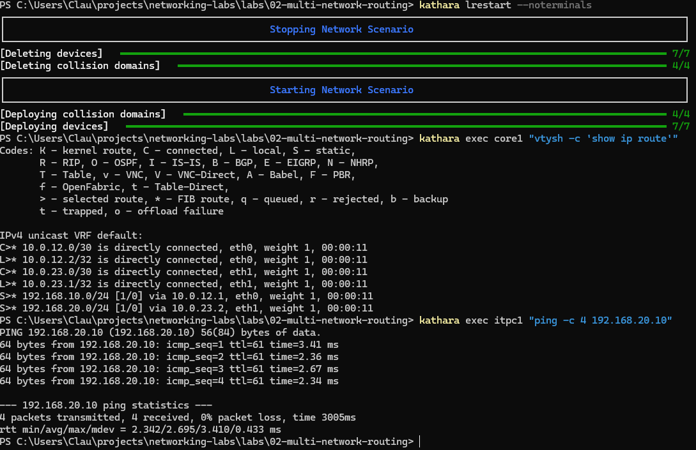

<details>
<summary>View additional successful FRR ping before the final restart</summary>

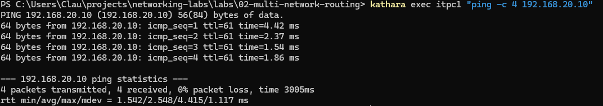

</details>

## Key takeaways

1. **Directly connected networks do not require a router**, but communication between HQ and BRANCH does.
2. **Routing must work in both directions** for an ICMP Echo Request and Reply exchange to complete.
3. A `/30` addressing plan fits the two-node inter-router links used here.
4. **Traceroute reveals each forwarding router** along the path.
5. **Routers rewrite Layer 2 headers and decrement IPv4 TTL** when forwarding traffic.
6. **FRRouting installs routing information into Linux**, rather than forwarding packets independently of the kernel.
7. **Reproducible startup matters:** the lab was validated after all seven Kathara containers were recreated.

## Evidence and related files

- [Packet Tracer diagram (`.pkt`)](topology/network-topology.pkt) — editable visualization only
- [Network topology image](topology/network-topology.png)
- [EDGE1 incoming capture](shared/edge1-eth0.pcap) and [outgoing capture](shared/edge1-eth1.pcap)
- [EDGE1 FRR configuration](shared/edge1-frr.conf), [CORE1 FRR configuration](shared/core1-frr.conf), [EDGE2 FRR configuration](shared/edge2-frr.conf)
- [Earlier Linux static-routing scripts](configs/static-routing/)
- [All test screenshots](screenshots/) — numbered in chronological order, including supplemental evidence not embedded inline

---

*This repository contains an independently documented practical network simulation. Measurements shown above were collected inside a local Kathara/Docker environment and are not performance benchmarks for physical network equipment.*
